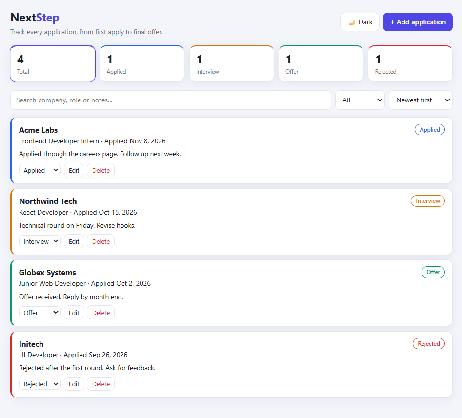
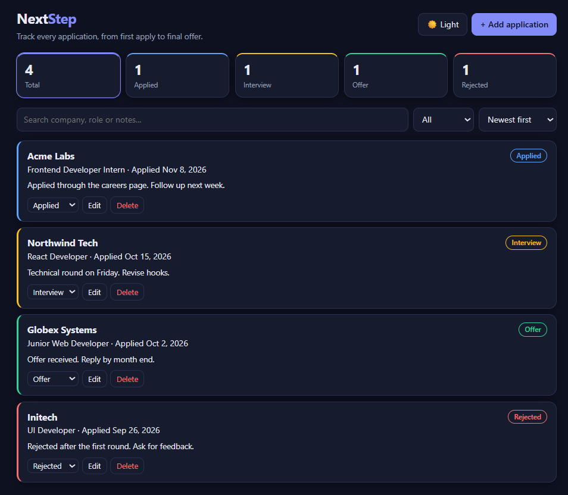
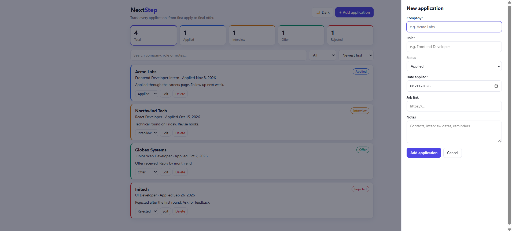
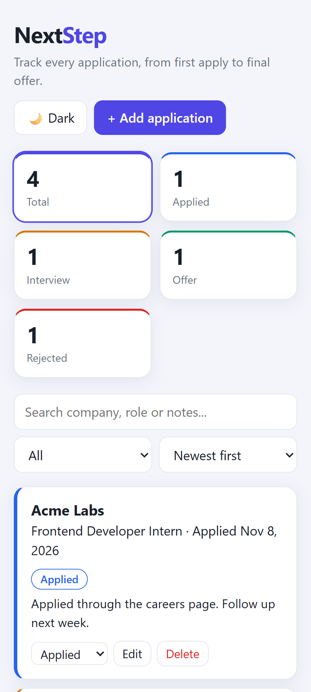

# NextStep

A job application tracker I built with React and Vite. I made it because I was applying to a lot of companies and kept forgetting where I had applied and what happened next.






## What it does

You can add, edit and delete applications. Each one has a company, role, status, date, link and notes. The status can be Applied, Interview, Offer or Rejected. You can search, filter by status and sort by date or company. The cards at the top show how many applications are in each status, and you can click them to filter. There is also a dark mode.

## How it works

It is a React app with no backend. The data is saved in the browser using Local Storage. I wrote a small custom hook called `useLocalStorage` so the saving and loading code is in one place.

## What I learned

- How to split a page into components and pass data with props
- Keeping the state in App and passing it down, instead of keeping copies in many places
- Why the counts at the top are calculated from the list instead of stored separately
- Building a form with validation that works for both add and edit
- Local Storage is saved per origin (including the port). My data looked lost once because the dev server started on a different port.
- A date written as `26-09-2026` showed "Invalid Date". It has to be `2026-09-26`.

## Tech used

React, JavaScript, HTML, CSS, Vite, Local Storage

## Run it locally

```
npm install
npm run dev
```

## What I want to add

- Export to CSV
- Interview dates
- A backend and login so the data works on more than one device
